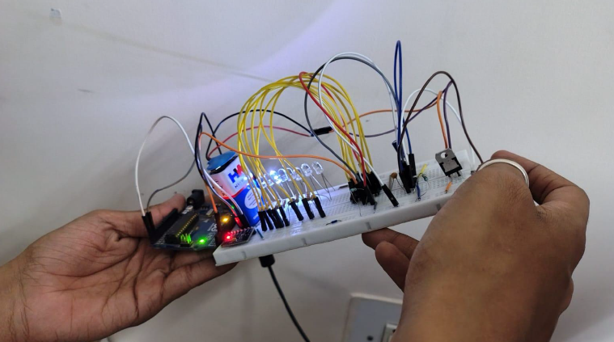

# MPU6050-Based Tilt-Controlled LED Water Flow System

An electronics project that combines motion sensing, Arduino-based processing, timer circuits, and sequential LED control to create a water-flow-like lighting effect.

\

&#x20; \
\

## Overview

This project explores how physical tilt can be used as an input to control a directional LED lighting pattern. An MPU6050 inertial measurement unit (IMU) provides motion data to an Arduino Uno, which processes the sensor input. A 555 timer and CD4017 decade counter form part of the LED sequencing system.

The completed hardware produces a flowing LED pattern whose direction changes when the setup is tilted left or right.

## Objectives

- Interface an MPU6050 sensor with an Arduino Uno.
- Read motion data using the I²C communication protocol.
- Explore microcontroller-based tilt input processing.
- Use timer and counter ICs for sequential LED control.
- Demonstrate a directional lighting effect using electronic hardware.

## Hardware Components

| Component                   | Purpose                                                         |
| --------------------------- | --------------------------------------------------------------- |
| Arduino Uno                 | Reads and processes sensor data                                 |
| MPU6050 IMU                 | Measures acceleration and rotational motion                     |
| NE555 timer                 | Generates timing pulses                                         |
| CD4017 decade counter       | Sequences the LED outputs                                       |
| LEDs                        | Produce the water-flow visual effect                            |
| 7805 voltage regulator      | Provides regulated voltag |
| Resistors and capacitors    | Support the electronic circuits                                 |
| Breadboard and jumper wires | Circuit assembly and connections                                |
| Battery / power supply      | Powers the hardware                                             |

## System Architecture

1. **Motion sensing:** The MPU6050 measures motion-related data.
2. **Input processing:** The Arduino Uno reads the sensor data through I²C and processes the tilt input.
3. **Timing stage:** The 555 timer provides timing pulses for the sequential lighting circuit.
4. **Sequencing stage:** The CD4017 advances the LED output sequence.
5. **Visual output:** The LEDs create the water-flow-like effect.

*This is a functional overview. The precise signal path and direction-control implementation should be confirmed against the final working circuit before publishing a detailed schematic.*

## Communication and Control

### MPU6050 and I²C

The MPU6050 communicates with the Arduino Uno over the I²C bus. The project report identifies SDA and SCL as the data and clock lines, respectively.

### 555 Timer

The NE555 timer is used as a timing-signal generator in the LED sequencing system.

### CD4017 Decade Counter

The CD4017 provides sequential outputs. As clock pulses arrive, the active output advances through the counter's sequence, creating a chasing-light effect.

## Observed Output

- The LEDs produce a water-flow-like lighting pattern.
- Tilting the setup left changes the flow direction.
- Tilting it right changes the flow to the opposite direction.

These observations describe the behaviour of the completed hardware; detailed timing measurements and the verified circuit connections can be added separately.

## Hardware Implementation

\

&#x20; \
\

\

&#x20; \
\

The system was assembled on a breadboard using an Arduino Uno, sensor module, timer and counter circuitry, LEDs, and supporting components.

## Demonstration Video

[Watch the project demonstration](https://drive.google.com/file/d/11XFE1I9LY9btV2jXLlPxMuIpCOrD85qe/view?usp=drivesdk)

## Repository Contents

- `assets/` — project photographs and supporting images
- `docs/` — system block diagram and additional documentation
- `code/` — Arduino source code, once verified against the working implementation

## Key Learning Areas

- Sensor interfacing and I²C communication
- Arduino-based input processing
- Timer and decade-counter circuits
- Sequential LED control
- Hardware assembly, testing, and troubleshooting

## Project Status

- [x] Hardware prototype completed
- [x] Tilt-responsive LED flow demonstrated
- [ ] Verify and document the final circuit connections
- [ ] Add the validated circuit schematic
- [ ] Publish the verified Arduino source code

## Acknowledgement

This project was developed as a team-based course project. Appropriate team credits and course acknowledgement can be added to this public portfolio version.

---

*Documentation describes the implemented project at a functional level. Pin-level connections, component values, and implementation details will be included once verified against the original build.*
