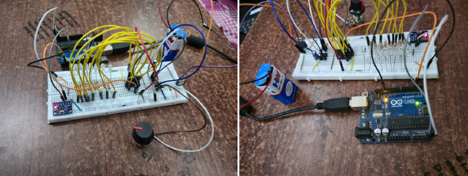

# MPU6050-Based Tilt-Controlled LED Water Flow System

An electronics project combining motion sensing, Arduino-based processing, timer circuits, and sequential LED control to create a water-flow-like lighting effect.

  

## Overview

This project explores how physical tilt can be used as an input to control a directional LED lighting pattern. An MPU6050 inertial measurement unit (IMU) provides motion data to an Arduino Uno, which processes the sensor input. A 555 timer and CD4017 decade counter form part of the LED sequencing system.

The completed hardware produces a flowing LED pattern whose direction changes when the setup is tilted left or right.

## Objectives

- Interface an MPU6050 sensor with an Arduino Uno.
- Read motion data using the I²C communication protocol.
- Explore microcontroller-based tilt input processing.
- Use timer and counter ICs for sequential LED control.
- Demonstrate a directional lighting effect using electronic hardware.

## Hardware Components

| Component | Purpose |
|---|---|
| Arduino Uno | Reads and processes sensor data |
| MPU6050 IMU | Measures acceleration and rotational motion |
| NE555 timer | Timing circuit |
| CD4017 decade counter | Sequential LED control |
| LEDs | Produce the water-flow visual effect |
| 7805 voltage regulator | Voltage regulation |
| Resistors and capacitors | Supporting circuit components |
| Breadboard and jumper wires | Circuit assembly and connections |
| Power supply | Powers the hardware |

## System Architecture

1. **Motion sensing:** The MPU6050 measures motion-related data.
2. **Input processing:** The Arduino Uno reads sensor data through I²C and processes the tilt input.
3. **Timing stage:** The 555 timer forms part of the timing circuit.
4. **Sequencing stage:** The CD4017 provides sequential outputs.
5. **Visual output:** The LEDs create the water-flow-like effect.

*This is a functional overview, not a verified pin-level schematic.*

## Communication and Control

### MPU6050 and I²C

The MPU6050 communicates with the Arduino Uno using the I²C bus. SDA carries data, while SCL provides the clock signal.

### 555 Timer

The NE555 timer is used in the timing circuitry.

### CD4017 Decade Counter

The CD4017 provides sequential outputs used in LED sequencing.

## Observed Output

- The LEDs produce a water-flow-like lighting pattern.
- The flow direction changes when the setup is tilted left or right.

## Hardware Implementation

The system was assembled on a breadboard using an Arduino Uno, sensor module, timer and counter circuitry, LEDs, and supporting components.

## Demonstration Video

[Watch the project demonstration](https://drive.google.com/file/d/11XFE1I9LY9btV2jXLlPxMuIpCOrD85qe/view?usp=drivesdk)

*Make sure the video sharing permissions allow viewers with the link to access it.*

## Repository Contents

- `assets/` — hardware photographs
- `docs/` — project diagrams and documentation
- `code/` — source code, once verified against the final implementation

## Key Learning Areas

- Sensor interfacing and I²C communication
- Arduino-based input processing
- Timer and decade-counter circuits
- Sequential LED control
- Hardware assembly and troubleshooting

## Project Status

## Project Status

- [x] Hardware prototype completed
- [x] Tilt-responsive LED flow demonstrated
- [x] Hardware photographs added
- [x] Arduino code transcribed from the project report
- [x] Transcribed code verified against the final working hardware
- [x] Final circuit connections documented
- [x] Validated circuit schematic added
- [x] Final Arduino source code published

## Acknowledgement

This was a team-based course project. Team contributions will be credited appropriately in the project documentation.

---

*Pin-level connections, component values, and implementation details will be documented once verified against the original build.*
